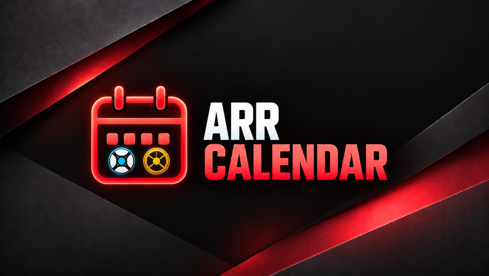
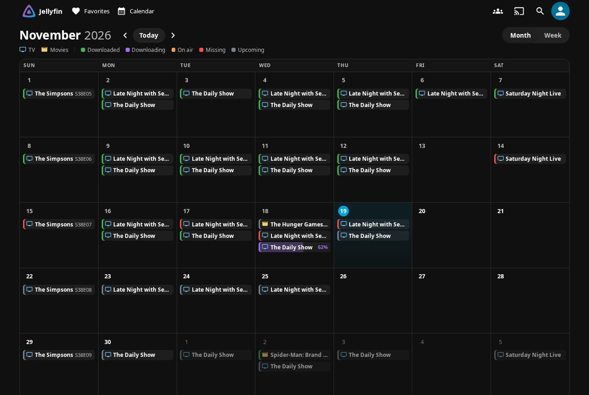
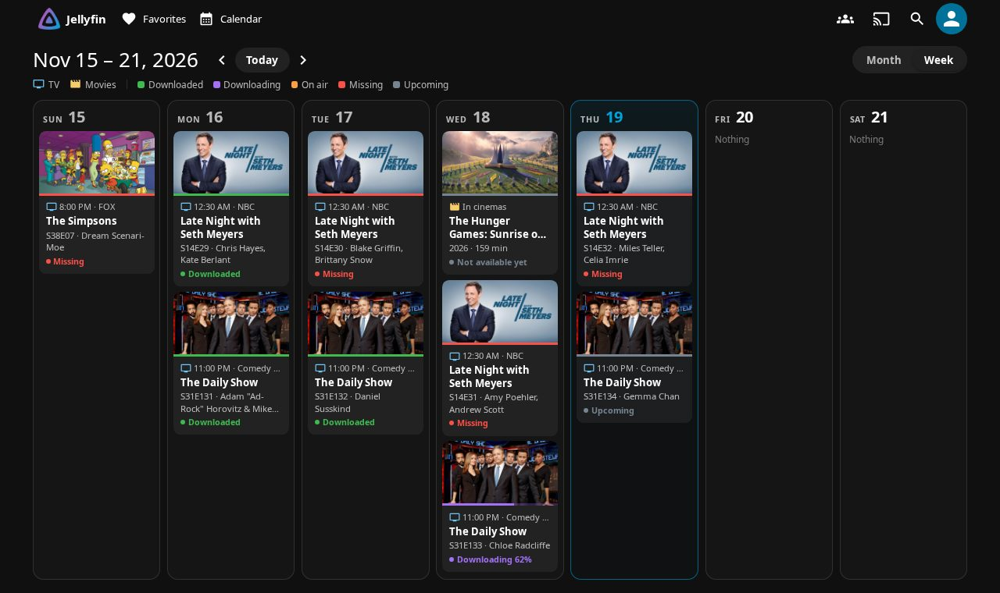
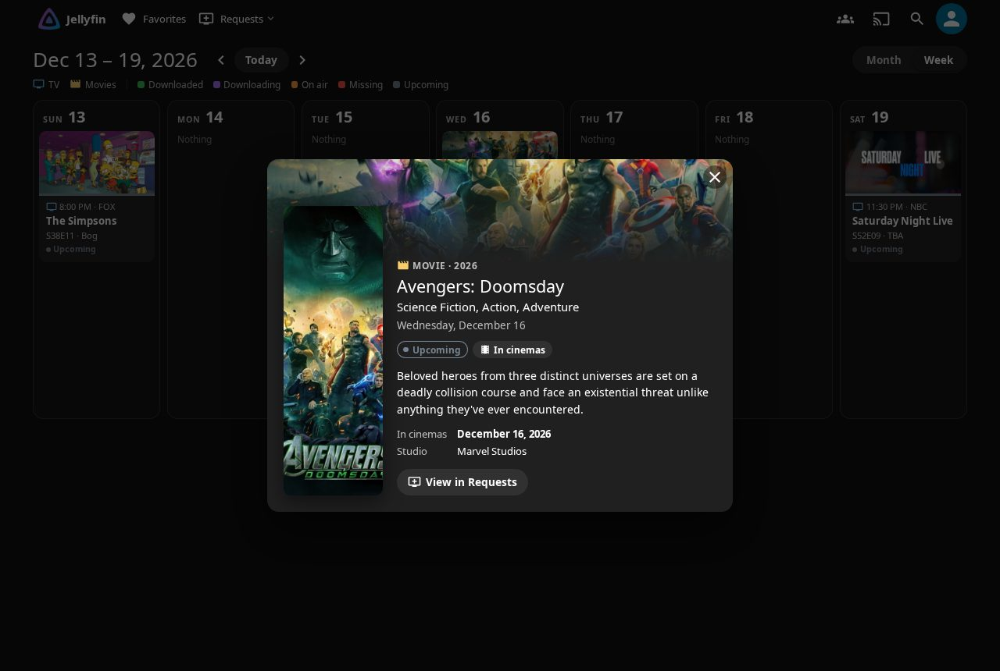
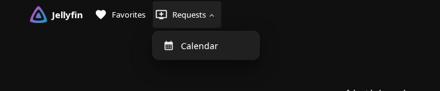
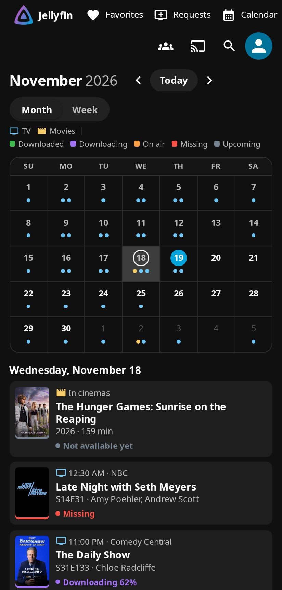

  

# jellyfin-plugin-arr-calendar

  
  
  
  
  
  
  

A Jellyfin plugin that adds a **Calendar** page to Jellyfin Web: upcoming episodes from Sonarr and movie releases from Radarr, together in one month or week view, with what is already downloaded, what is missing, what is on air right now, and how far each download has got. Sonarr's and Radarr's API keys stay on the Jellyfin server; browsers only ever see the calendar.

  

  

  

## Features

- Month and week views (month by default on a computer, week on a phone), with Today and arrows, the arrow keys, or a swipe to page through them
- TV and movies told apart at a glance: a screen or a clapperboard on every entry, in Sonarr blue and Radarr gold, with episode codes for TV and the release (in cinemas, digital, physical) for movies
- Status on every entry, as in Sonarr and Radarr: downloaded, downloading, on air now, missing, upcoming
- Live download progress from Sonarr's and Radarr's queues, as a percentage, a progress bar and the time left
- A season released at once shown as one entry, with every episode in its details
- Details with artwork, the episode or movie overview, air time in your own time zone, premieres and finales, and every release date of a movie
- Go to episode, Go to series or Go to movie when it is already in your Jellyfin library
- With [Seerr Integration](https://github.com/voc0der/jellyfin-plugin-seerr-integration): Calendar tucks under Requests as a small menu on devices with a mouse, stays its own entry on phones and tablets, and details link to the title in Requests
- A compact month with the chosen day listed underneath on phones
- Follows the active Jellyfin theme, light or dark, and the week, date and time conventions of your language

  

  

## Requirements

- Jellyfin 12
- [JavaScript Injector](https://github.com/n00bcodr/Jellyfin-JavaScript-Injector), which loads the page into Jellyfin Web
- Sonarr (v4 or v5), Radarr (v5 to v7), or both, reachable from the Jellyfin server

## Installation

### Plugin Catalog

1. Open **Dashboard -> Plugins -> Repositories**
2. Add `https://raw.githubusercontent.com/voc0der/jellyfin-plugin-arr-calendar/main/manifest.json`
3. Install **Arr Calendar** from **Catalog**
4. Install **JavaScript Injector** if it is not installed yet
5. Restart Jellyfin

> [!NOTE]
> Full repository of this author's plugins: [voc0der/jellyfin-plugins](https://github.com/voc0der/jellyfin-plugins).

### Manual Install

1. Download the latest ZIP from the releases page
2. Extract it into your Jellyfin plugins directory
3. Restart Jellyfin

## Setup

Open **Dashboard -> Plugins -> Arr Calendar**:

- **Sonarr** and **Radarr**: each one's address as the Jellyfin server reaches it, including any URL base (for example `http://sonarr:8989`), and its API key from **Settings -> General**. Use **Test connection** to check each one; it also catches a Radarr address typed into the Sonarr fields. HTTPS certificates are verified, except on private and loopback addresses (for example `https://192.168.1.20:8989`), where self-signed certificates are accepted
- **Include unmonitored episodes and movies**: off by default, so the calendar shows what Sonarr and Radarr are watching for
- **Don't specify method**: the Calendar says "Ready" instead of "Downloaded" and "Pending" instead of "Downloading" everywhere, so it never mentions how titles reach your library
- **Timeout**: how long to wait for either service before showing the calendar without it

Reload Jellyfin Web, and **Calendar** appears in the navigation for every signed-in user. Leave a service's address empty to show only the other.

## Keeping the API keys safe

The page asks this plugin for the calendar as the signed-in user. The plugin asks Sonarr and Radarr itself, and hands back only the entries it built, never their answers, which carry server paths. Artwork is fetched from Sonarr's and Radarr's own covers and served through Jellyfin by signed URL, so browsers never contact Sonarr, Radarr, TVDB or TMDB.

A key saved on the settings page can be read back by any Jellyfin administrator credential. To keep it out of Jellyfin's configuration, set `ARR_CALENDAR_SONARR_API_KEY_FILE` and `ARR_CALENDAR_RADARR_API_KEY_FILE` (or the same names without `_FILE`, holding the key itself) in Jellyfin's environment. The environment wins, and the settings page shows the key as supplied by it. Details are in [docs/DESIGN.md](docs/DESIGN.md).

## Build Manually

See [CONTRIBUTING.md](CONTRIBUTING.md) for development information.
